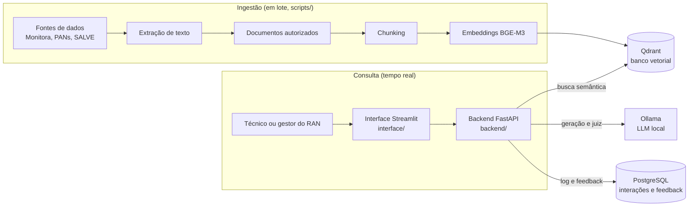
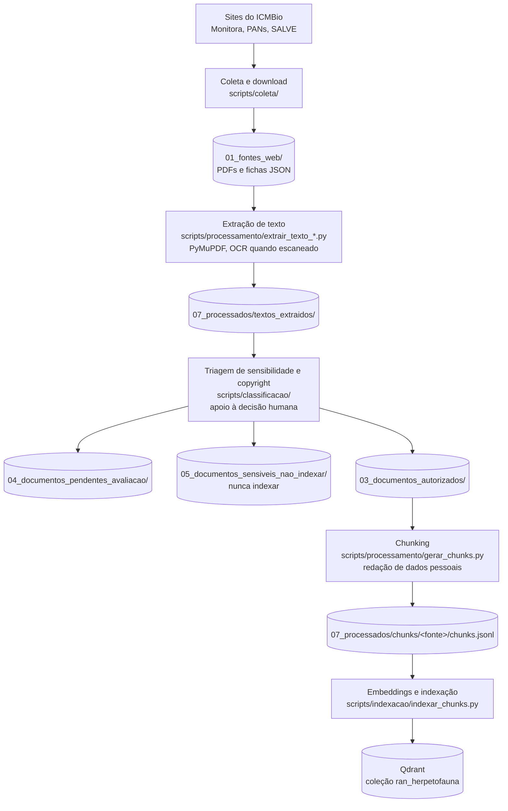
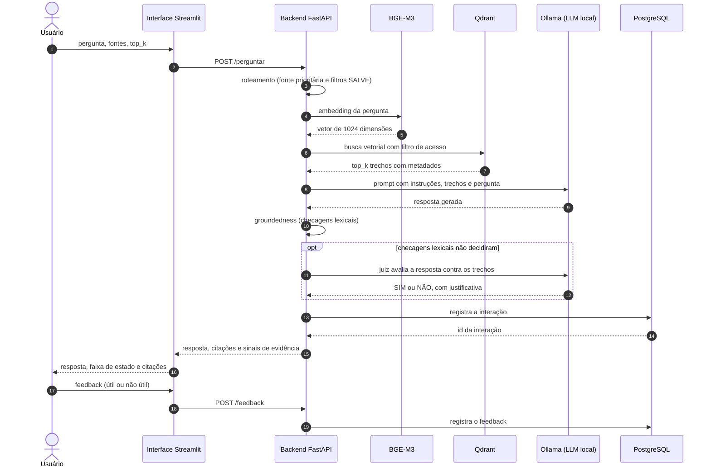
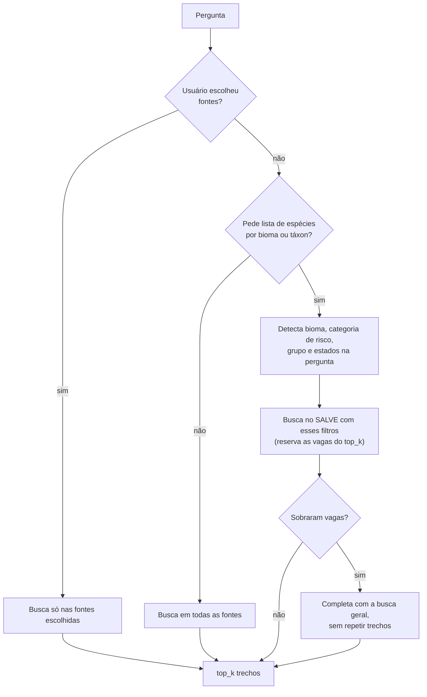
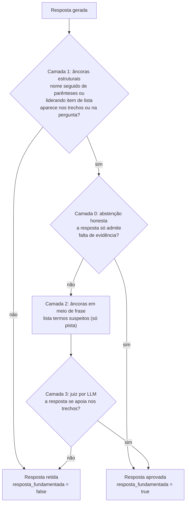
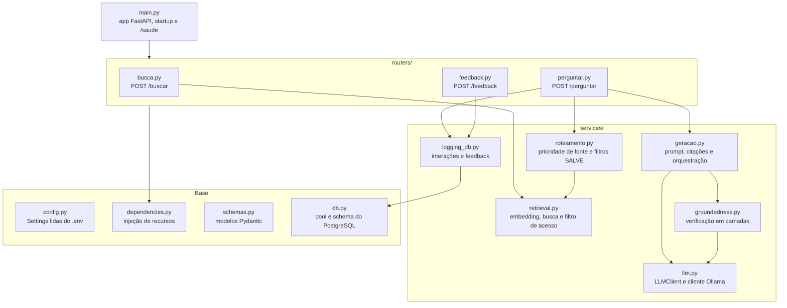
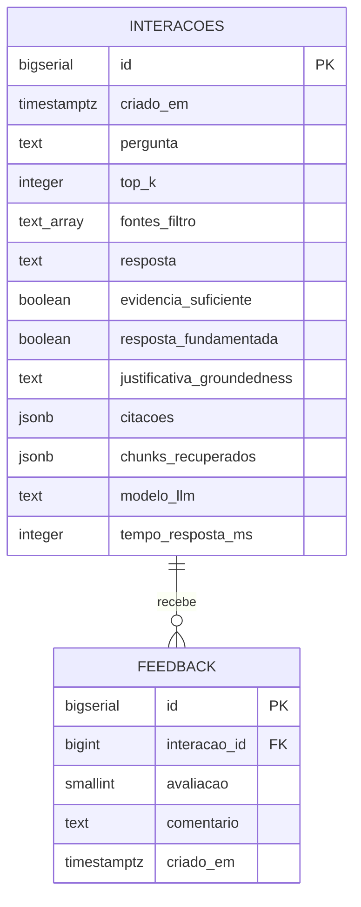
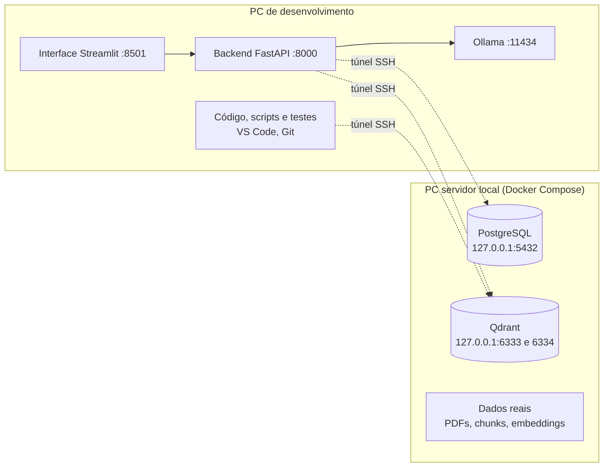

# HerpIA — Assistente Inteligente para Consulta de Informações sobre a Herpetofauna Brasileira

**Nome técnico:** Sistema RAG para Consulta Inteligente de Dados sobre a Herpetofauna Brasileira — RAN/ICMBio

Projeto de chatbot interno baseado em RAG (Retrieval-Augmented Generation) para facilitar a consulta a informações sobre a herpetofauna brasileira, apoiando técnicos e gestores do RAN/ICMBio no acesso a dados ambientais, científicos e institucionais. O sistema recupera trechos de uma base de conhecimento previamente organizada e gera respostas fundamentadas nesses trechos, sempre com as fontes citadas.

## Sumário

- [Status do projeto](#status-do-projeto)
- [Público-alvo](#público-alvo)
- [Fontes de dados](#fontes-de-dados)
- [Visão geral do sistema](#visão-geral-do-sistema)
- [Pipeline de ingestão](#pipeline-de-ingestão)
- [Sistema de RAG: fluxo de uma pergunta](#sistema-de-rag-fluxo-de-uma-pergunta)
- [Backend (FastAPI)](#backend-fastapi)
- [Interface (Streamlit)](#interface-streamlit)
- [Infraestrutura](#infraestrutura)
- [Estrutura do repositório](#estrutura-do-repositório)
- [Como rodar](#como-rodar)
- [Avaliação e diagnósticos](#avaliação-e-diagnósticos)
- [Dados sensíveis](#dados-sensíveis)
- [Identidade visual](#identidade-visual)
- [Documentação](#documentação)

## Status do projeto

Em desenvolvimento. Coleta, extração de texto e chunking concluídos para Monitora, PANs e SALVE (**59.085 trechos**, indexados no Qdrant com embeddings BGE-M3). O backend FastAPI responde de ponta a ponta (`/buscar`, `/perguntar`, `/feedback`, `/saude`), com geração via LLM local (Ollama), verificação de groundedness e registro de feedback em PostgreSQL. O protótipo de interface em Streamlit está funcional, com a identidade oficial do RAN/ICMBio aplicada.

Pendentes: classificação de sensibilidade individual formal, exportação do SEI (depende de autorização da equipe do RAN), busca híbrida, autenticação e validação com usuários. Status detalhado por fase em [`docs/roadmap.md`](./docs/roadmap.md). Prazo previsto de até um ano para conclusão; a base de conhecimento será atualizada semestralmente.

## Público-alvo

- Técnicos do RAN/ICMBio
- Gestores do RAN/ICMBio
- Pesquisadores vinculados ao RAN

## Fontes de dados

| Fonte | Conteúdo | Situação na base |
|---|---|---|
| Programa Monitora do ICMBio | Relatórios, protocolos e documentos de monitoramento | Indexado (7.220 trechos) |
| PANs | Planos de Ação Nacional para espécies ameaçadas | Indexado (31.796 trechos) |
| SALVE | Fichas de avaliação de risco de répteis e anfíbios | Indexado (20.069 trechos) |
| Publicações científicas do RAN | Artigos, boletins, teses, capítulos | Catalogadas; aguardam avaliação de sensibilidade e copyright |
| SEI/ICMBio | Processos e documentos administrativos | Catalogado; exportação depende de autorização do RAN |

Detalhes e URLs em [`docs/fontes-de-dados.md`](./docs/fontes-de-dados.md) e `01_fontes_web/urls_fontes.md`.

## Visão geral do sistema

O sistema tem duas metades: a **ingestão**, que roda em lote por scripts e alimenta o banco vetorial, e a **consulta**, que atende as perguntas em tempo real.



Tecnologias em uso:

| Camada | Tecnologia |
|---|---|
| Linguagem | Python |
| Extração de PDFs | PyMuPDF, com Tesseract OCR para PDFs escaneados |
| Embeddings | `BAAI/bge-m3` via sentence-transformers (1024 dimensões, distância cosseno), escolha temporária — [ADR 0005](./docs/decisoes/0005-escolha-temporaria-modelo-embeddings.md) |
| Banco vetorial | Qdrant (servidor via Docker ou modo embutido em disco) |
| LLM de geração | Modelo local via Ollama (`qwen2.5:3b-instruct` por padrão), escolha temporária — [ADR 0006](./docs/decisoes/0006-escolha-temporaria-llm-geracao.md) |
| Backend | FastAPI + Uvicorn |
| Dados estruturados | PostgreSQL 16 (interações e feedback) |
| Interface | Streamlit |
| Implantação | Docker Compose (PostgreSQL e Qdrant) |

Tudo roda localmente: nem os embeddings nem a geração dependem de API paga.

## Pipeline de ingestão

Cada etapa lê de uma pasta e grava em outra; dados brutos (`01_*`, `02_*`) nunca se misturam com dados processados (`07_processados/`).



**Chunking.** O alvo é de cerca de 2.000 caracteres por trecho, com sobreposição de cerca de 200, respeitando limites de parágrafo e sentença:

- **SALVE:** um trecho por seção da ficha (taxonomia, distribuição, ameaças etc.), com um cabeçalho de metadados da espécie.
- **Monitora e PANs:** janela deslizante sobre o texto por página, registrando página inicial e final.

Padrões estruturados de dados pessoais são redigidos durante o chunking (`scripts/classificacao/regras_pii.py`).

**Metadados de cada trecho.** Todo trecho indexado carrega fonte, documento, seção ou página, URL de origem, caminho local, data de coleta e nível de sensibilidade. As fichas SALVE têm ainda bioma, categoria de risco, grupo (anfíbios ou répteis) e estados, usados como filtro na busca.

**Indexação.** É idempotente: o ID de cada ponto no Qdrant deriva do `chunk_id`, então reindexar atualiza em vez de duplicar. `--fonte` indexa uma fonte por vez e `--retomar` continua uma indexação interrompida.

Processos detalhados em [`docs/processos/`](./docs/processos/): [coleta](./docs/processos/coleta_fontes_web.md), [extração de PDFs](./docs/processos/extracao_pdfs.md), [chunking](./docs/processos/chunking.md), [embeddings](./docs/processos/embeddings.md) e [classificação de sensibilidade](./docs/processos/classificacao_sensibilidade.md).

## Sistema de RAG: fluxo de uma pergunta

O endpoint `POST /perguntar` percorre recuperação, geração e verificação antes de devolver a resposta.



### Recuperação e roteamento

A busca é semântica (vetor denso), com dois filtros aplicados dentro do Qdrant:

- **Filtro de acesso:** só trechos com `nivel_sensibilidade = "autorizado"` podem ser recuperados. É a segunda camada de defesa; a primeira é não indexar o que não foi autorizado.
- **Filtro de fonte:** opcional, escolhido pelo usuário na interface.

Para perguntas do tipo "lista de espécies por bioma ou táxon", o roteamento (`backend/services/roteamento.py`) reserva vagas para o SALVE, porque sem isso os parágrafos genéricos dos PANs dominam o resultado.



A detecção é por palavra-chave e pode errar em perguntas ambíguas; o histórico está em [`diagnosticos/retrieval-cerrado-anfibios.md`](./diagnosticos/retrieval-cerrado-anfibios.md) e [`diagnosticos/agregacao-biomas-fichas-salve.md`](./diagnosticos/agregacao-biomas-fichas-salve.md).

### Geração

O prompt (`backend/services/geracao.py`) junta as instruções do sistema, os trechos recuperados (cada um rotulado com fonte e documento) e a pergunta. As instruções exigem responder só com o que está nos trechos, citar as fontes, sintetizar trechos parciais quando juntos cobrem a resposta e declarar a falta de evidência em vez de especular. Só os trechos recuperados vão ao LLM, nunca documentos completos.

Dois casos são resolvidos antes de chamar o LLM:

- **Nenhum trecho recuperado:** devolve a mensagem de evidência insuficiente.
- **Pergunta cita o SEI:** como o SEI ainda não está indexado, devolve um aviso fixo em vez de deixar o modelo especular a partir de trechos de outras fontes.

### Verificação de groundedness

Depois da geração, `backend/services/groundedness.py` confere se a resposta se apoia nos trechos. Uma resposta reprovada é substituída por uma mensagem de retenção, e o motivo vai em `justificativa_groundedness`.



- **Camada 1** decide sozinha: um nome de espécie ou citação que não aparece em lugar nenhum é fabricação com alta confiança.
- **Camada 0** evita gastar uma chamada ao juiz, que tende a reprovar abstenções corretas.
- **Camada 2** não decide, porque texto institucional capitaliza muitos termos legítimos; ela só informa o juiz.
- **Camada 3** é a única que pega informação verdadeira atribuída ao documento errado, mas é fraca com o modelo local atual. A comparação de juízes alternativos está em [`diagnosticos/juizes/`](./diagnosticos/juizes/).

A verificação pode ser desligada com `GROUNDEDNESS_VERIFICAR=false`, o que evita a chamada extra ao LLM (a verificação quase dobra a latência de `/perguntar`), mas só deve ser feito em desenvolvimento.

### O que a resposta traz

| Campo | Significado |
|---|---|
| `resposta` | Texto gerado, ou a mensagem de retenção ou de falta de evidência |
| `citacoes` | Fonte, documento, seção, páginas, URL e o texto do trecho, sem repetir documento e página |
| `evidencia_suficiente` | Se algum trecho foi recuperado |
| `resposta_fundamentada` | Se a resposta passou na verificação de groundedness |
| `justificativa_groundedness` | Motivo da retenção, quando houver |
| `id` | Identificador da interação, usado para enviar feedback |

## Backend (FastAPI)

### Endpoints

| Método e rota | Função |
|---|---|
| `POST /buscar` | Busca semântica pura, sem geração; serve para depurar a recuperação |
| `POST /perguntar` | Fluxo completo de RAG: roteamento, busca, geração, groundedness e log |
| `POST /feedback` | Registra avaliação (útil ou não útil) e comentário opcional de uma resposta |
| `GET /saude` | Estado do serviço e configuração do LLM em vigor |

Documentação interativa em `http://localhost:8000/docs` com o backend no ar.

### Módulos



Os recursos pesados (modelo de embeddings, cliente Qdrant, cliente LLM e pool do PostgreSQL) são carregados uma única vez na inicialização e reaproveitados em todas as requisições.

O LLM fica atrás da interface `LLMClient.generate(prompt)`: trocar de modelo local ou migrar para uma API paga exige apenas uma nova implementação, sem mexer na recuperação nem nas citações. Hoje só o provedor `ollama` está implementado.

Se o PostgreSQL não estiver acessível na inicialização, o backend sobe mesmo assim: `/buscar` e `/perguntar` funcionam, a resposta vem sem `id` e `/feedback` devolve 503.

### Banco de dados



O schema é criado automaticamente na inicialização do backend (`backend/db.py`). `avaliacao` vale `1` (útil) ou `-1` (não útil).

### Configuração

As variáveis ficam no `.env` (modelo em [`.env.example`](./.env.example)); o `.env` nunca é versionado.

| Variável | Função | Padrão |
|---|---|---|
| `DATABASE_URL` | Conexão com o PostgreSQL | — |
| `QDRANT_URL` | Endereço do Qdrant em modo servidor | `http://localhost:6333` |
| `QDRANT_LOCAL_PATH` | Diretório do Qdrant em modo embutido; quando definido, ignora `QDRANT_URL` | não definido |
| `QDRANT_COLLECTION` | Nome da coleção | `ran_herpetofauna` |
| `LLM_PROVIDER` | Provedor do LLM | `ollama` |
| `OLLAMA_URL` | Endereço do Ollama | `http://localhost:11434` |
| `LLM_MODEL` | Modelo de geração | `qwen2.5:3b-instruct` |
| `LLM_NUM_CTX` | Tamanho do contexto enviado ao Ollama | `8192` |
| `LLM_TEMPERATURE`, `LLM_SEED`, `LLM_THINK`, `LLM_TIMEOUT` | Parâmetros opcionais do LLM | padrão do modelo; timeout de 120 s |
| `GROUNDEDNESS_VERIFICAR` | Liga a verificação pós-geração | `true` |
| `BACKEND_API_URL` | Endereço do backend usado pela interface | `http://localhost:8000` |

Mais detalhes em [`docs/processos/backend_fastapi.md`](./docs/processos/backend_fastapi.md).

## Interface (Streamlit)

O protótipo em `interface/` é um chat que consome o backend por HTTP:

- **`app.py`:** tela de consulta, com pergunta em linguagem natural, resposta, faixa de estado (fundamentada, retida ou sem evidência), citações em cartão com o texto do trecho, e feedback com comentário opcional. A barra lateral traz o filtro por fonte e o número de trechos.
- **`cliente_api.py`:** chamadas ao backend (`/perguntar`, `/feedback`, `/saude`), isoladas da lógica de exibição.
- **`tema.py`:** tokens, CSS e componentes portados do design system.

Ainda faltam persistência do histórico entre sessões e autenticação. Ver [`docs/processos/interface_streamlit.md`](./docs/processos/interface_streamlit.md).

## Infraestrutura

O protótipo roda na máquina local de desenvolvimento. O projeto também está preparado para dois computadores em rede local, com o acesso feito por túnel SSH e sem expor serviços na rede.



```bash
ssh -N -L 5432:localhost:5432 -L 6333:localhost:6333 usuario@IP_DO_SERVIDOR
```

- As portas `5432`, `6333` e `6334` ficam restritas a `127.0.0.1` no `docker-compose.yml`.
- Enquanto o servidor não está configurado, o Qdrant pode rodar em modo embutido (`QDRANT_LOCAL_PATH`), sem Docker e sem rede.
- A migração para um servidor dedicado do RAN/ICMBio só deve ocorrer depois da validação do protótipo ([ADR 0003](./docs/decisoes/0003-infraestrutura-prototipo-local-antes-de-servidor-dedicado.md)).

Guia completo em [`docs/infraestrutura-local.md`](./docs/infraestrutura-local.md).

## Estrutura do repositório

```
chatbot-ran-icmbio/
├── 01_fontes_web/                       # Fontes web coletadas e metadados de coleta
│   ├── monitora/
│   ├── pans/
│   ├── salve/
│   └── sei/                             # só catálogo; nenhum documento exportado
├── 02_publicacoes_cientificas_ran/      # Publicações dos pesquisadores do RAN
├── 03_documentos_autorizados/           # Avaliados e autorizados para indexação
├── 04_documentos_pendentes_avaliacao/   # Ainda não avaliados
├── 05_documentos_sensiveis_nao_indexar/ # Sensíveis: nunca indexar nem enviar a API externa
├── 06_inventario/                       # Inventário e catálogos das fontes
├── 07_processados/                      # Saídas dos pipelines
│   ├── textos_extraidos/
│   ├── chunks/
│   └── metadados/
│
├── backend/                             # API FastAPI
│   ├── main.py                          # app, startup e /saude
│   ├── config.py                        # Settings lidas do .env
│   ├── db.py                            # pool e schema do PostgreSQL
│   ├── dependencies.py                  # injeção de recursos nos endpoints
│   ├── schemas.py                       # modelos Pydantic
│   ├── routers/                         # busca.py, perguntar.py, feedback.py
│   └── services/                        # retrieval, roteamento, geracao,
│                                        # groundedness, llm, logging_db
│
├── interface/                           # Protótipo em Streamlit
│   ├── app.py
│   ├── cliente_api.py
│   └── tema.py
│
├── scripts/
│   ├── coleta/                          # coleta e download: Monitora, PANs, SALVE, SEI, publicações
│   ├── processamento/                   # extração de texto e chunking
│   ├── classificacao/                   # triagem de sensibilidade, copyright e regras de PII
│   ├── indexacao/                       # embeddings e indexação no Qdrant
│   ├── processamento_imagens/           # piloto de descrição de imagens de PDFs
│   ├── infra/                           # subir o Ollama e utilitários de máquina
│   ├── check_services.py                # verifica PostgreSQL e Qdrant
│   ├── diagnostico_retrieval.py         # diagnóstico da recuperação
│   └── teste_perguntas_dominio.py       # bateria de perguntas de domínio
│
├── diagnosticos/                        # Relatórios de avaliação e baterias de teste
├── docs/                                # Roadmap, processos e decisões (ADRs)
├── design-system/                       # Design system do HerpIA (somente leitura)
│
├── docker-compose.yml                   # PostgreSQL e Qdrant
├── requirements.txt
├── .env.example
├── SETUP_PROJETO.md                     # como subir o projeto
├── SETUP_WSL_CONEXAO_SERVIDOR.md
├── SETUP_DOWNLOAD_REMOTO.md
└── CLAUDE.md                            # contexto para sessões de IA
```

## Como rodar

Passo a passo completo em [`SETUP_PROJETO.md`](./SETUP_PROJETO.md). Resumo:

```bash
source venv/bin/activate
pip install -r requirements.txt       # só se houver dependência nova

scripts/infra/subir_ollama.sh         # LLM local
uvicorn backend.main:app --reload     # backend em http://localhost:8000
streamlit run interface/app.py        # interface

docker compose up -d                  # opcional: PostgreSQL e Qdrant em modo servidor
```

Sem o PostgreSQL, o sistema responde normalmente, mas não registra interações nem feedback.

## Avaliação e diagnósticos

A pasta [`diagnosticos/`](./diagnosticos/) guarda os relatórios das investigações de qualidade:

| Relatório | Assunto |
|---|---|
| [`teste-perguntas-dominio.md`](./diagnosticos/teste-perguntas-dominio.md) | Bateria de perguntas de domínio sobre o pipeline completo |
| [`criterios-avaliacao-bateria.md`](./diagnosticos/criterios-avaliacao-bateria.md) | Critérios de avaliação das respostas |
| [`retrieval-cerrado-anfibios.md`](./diagnosticos/retrieval-cerrado-anfibios.md) | Diagnóstico da recuperação que motivou o roteamento por fonte |
| [`agregacao-biomas-fichas-salve.md`](./diagnosticos/agregacao-biomas-fichas-salve.md) | Filtros por metadados das fichas SALVE |
| [`comparacao-geradores-rodada1.md`](./diagnosticos/comparacao-geradores-rodada1.md) | Comparação de modelos geradores locais |
| [`hipotese-concisao-respostas.md`](./diagnosticos/hipotese-concisao-respostas.md) | Hipótese de que respostas longas favorecem alucinação |
| [`juizes/`](./diagnosticos/juizes/) | Conjunto rotulado para comparar juízes de groundedness |

As execuções da bateria ficam em `diagnosticos/baterias/`. Para rodar uma nova, com o backend no ar: `python scripts/teste_perguntas_dominio.py`.

## Dados sensíveis

Este repositório não deve conter PDFs internos, documentos sensíveis, arquivos do SEI, dados pessoais ou informações ambientais restritas.

- Nenhum documento é indexado sem avaliação, autorização e classificação de sensibilidade.
- O que está em `04_documentos_pendentes_avaliacao/` e `05_documentos_sensiveis_nao_indexar/` nunca é processado automaticamente.
- O LLM recebe apenas os trechos recuperados e autorizados, nunca documentos completos.
- Chaves, senhas e o arquivo `.env` ficam fora do versionamento.

Regras completas em [`CLAUDE.md`](./CLAUDE.md) e no [ADR 0002](./docs/decisoes/0002-classificacao-de-sensibilidade-em-pastas.md).

## Identidade visual

O design system do HerpIA fica em [`design-system/`](./design-system/) — tokens de cor, tipografia, forma e movimento, componentes de referência, guidelines e o kit de telas. É um **artefato recebido e imutável**: correções e ressalvas ficam em [`docs/processos/design_system.md`](./docs/processos/design_system.md), nunca dentro do pacote.

A aplicação do sistema à interface Streamlit vive em `interface/tema.py` (tokens portados, CSS global, componentes de domínio) e `.streamlit/config.toml`. Sessões de IA devem usar a skill de projeto `herpia-design` (`.claude/skills/herpia-design/`), que aponta para os arquivos certos e registra as instruções desatualizadas do pacote.

## Documentação

| Onde | O que tem |
|---|---|
| [`docs/roadmap.md`](./docs/roadmap.md) | Fases, tarefas e status do projeto |
| [`docs/processos/`](./docs/processos/) | Como cada etapa foi feita (coleta, extração, chunking, embeddings, backend, interface) |
| [`docs/decisoes/`](./docs/decisoes/) | Decisões técnicas registradas (ADRs) |
| [`docs/infraestrutura-local.md`](./docs/infraestrutura-local.md) | Configuração dos dois computadores e do túnel SSH |
| [`docs/fontes-de-dados.md`](./docs/fontes-de-dados.md) | Descrição das fontes |
| [`CLAUDE.md`](./CLAUDE.md) | Contexto completo para desenvolvedores e sessões de IA |
